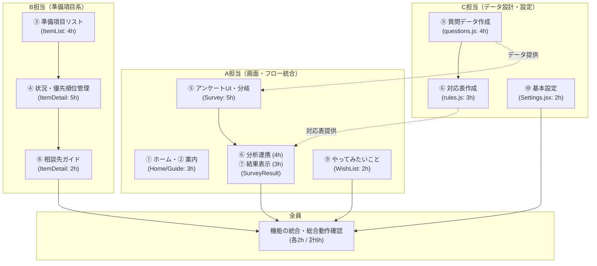

# 終活みちしるべ（Webアプリ版）- 3人チーム開発環境

本リポジトリは、終活サポートWebアプリ「**終活みちしるべ**」のチーム開発用リポジトリです。  
設計書（`設計.txt`）およびインタラクティブ・プロトタイプ（`終活みちしるべ_プロトタイプ.html`）をベースに、**React + Vite + React Router + Context API** で構築されています。

3人のメンバーが画面や機能ごとに分担し、競合（コンフリクト）を避けてスムーズに開発を進められる構成になっています。

---

## 1. クイックスタート（起動方法）

### 事前準備
Node.js（v18以上推奨）がインストールされていることを確認してください。

### コマンド
```bash
# 依存パッケージのインストール
npm install

# 開発サーバーの起動（ブラウザが自動で開きます）
npm run dev

# 本番用ビルド（構文エラーや型不整合の確認）
npm run build
```
起動後、ブラウザで `http://localhost:5173/` にアクセスしてください。

---

## 2. 画面一覧とURLマッピング

React Router により、各画面に個別URLが割り当てられています。**自分が担当する画面を直接URLで開いて動作確認**が可能です。

| No | 画面名 | URLパス | 対応するファイル | 主な機能・役割 |
|---|---|---|---|---|
| 01 | 初回案内 | `/guide` | `src/pages/Guide.jsx` | 3ステップ図解、使い方の説明、スキップ |
| 02 | ホーム・進捗確認 | `/` | `src/pages/Home.jsx` | 完了率、次の一歩Heroカード、メニュータイル |
| 03 | アンケート：分野選択 | `/survey` | `src/pages/SurveyTopics.jsx` | 分野チェック選択、全体確認ボタン |
| 04 | アンケート：設問 | `/survey/q` | `src/pages/SurveyQuestions.jsx` | 動的分岐質問、音声読み上げ（Web Speech API） |
| 05 | 質問結果・個別提案 | `/survey/result` | `src/pages/SurveyResult.jsx` | ルール分析結果、次の一歩提案、家族向けまとめ |
| 06 | 準備項目一覧 | `/items` | `src/pages/ItemList.jsx` | 7項目一覧、状態別フィルター、進捗表示 |
| 07 | 準備項目の詳細 | `/items/detail?id=...` | `src/pages/ItemDetail.jsx` | 6状態変更、手順チェック、公的相談先リンク |
| 08 | やってみたいことリスト | `/wishes` | `src/pages/WishList.jsx` | 楽しみの登録、ごほうび目標設定 |
| 09 | 基本設定 | `/settings` | `src/pages/Settings.jsx` | お名前変更、文字サイズ切替、データ全削除 |
| 10 | 希望・思い出の記録 | `/memories` | `src/pages/Memories.jsx` | 【+α】テーマ別文章作成、思い出アルバム |
| 11 | 家族との対話 | `/family` | `src/pages/FamilyTalk.jsx` | 【+α】対話ログ記録、ごほうび相談シミュレーション |

> 💡 **開発用ナビゲーションバー（画面最上部）**  
> 画面上部の黒いバーにある「**画面一覧・テスト**」ボタンを押すと、いつでも全画面へのジャンプや「初期状態」「サンプルデータ」の切り替えが可能です。

---

## 3. 3人のチーム分担計画（43h＋予備2h / 45h以内）

本プロジェクトで確定した担当者（A / B / C）ごとの作業名、必要時間、および**作業対象ファイル**の一覧です。

### 担当別 作業ファイル一覧

| 担当 | 作業名 | 必要時間 | 作業対象ファイル | 具体的な作業内容 |
|---|---|:---:|---|---|
| **A担当**<br>(計17h) | ① ホーム・進捗確認<br>② 初回案内・使い方サポート | 3h | `src/pages/Home.jsx`<br>`src/pages/Guide.jsx` | 完了率の表示、次の一歩Heroカード、初回3ステップ図解とスキップ処理の実装 |
| | ⑤ 生活状況アンケート・質問の分岐 | 5h | `src/pages/SurveyTopics.jsx`<br>`src/pages/SurveyQuestions.jsx` | 分野選択画面のUI、質問の動的分岐表示、回答の保存と画面遷移 |
| | ⑥ 回答内容の分析・準備項目の絞り込み | 4h | `src/context/AppContext.jsx`<br>`src/data/rules.js` | 回答データの受領とルール分析関数の呼び出し、ステート連携 |
| | ⑦ 質問結果・個別提案の表示 | 3h | `src/pages/SurveyResult.jsx` | 分析結果の描画、おすすめ次の一歩の強調表示、家族向けメモの出力 |
| | ⑨ やってみたいことリスト | 2h | `src/pages/WishList.jsx` | 楽しみの選択式追加、自由入力フォーム、ごほうび目標の設定 |
| **B担当**<br>(計11h) | ③ 準備項目リスト | 4h | `src/pages/ItemList.jsx` | 7項目の一覧表示、状態別タブフィルター（すべて/未完了/完了） |
| | ④ 準備状況・優先順位の管理 | 5h | `src/pages/ItemDetail.jsx`<br>`src/components/StatusBadge.jsx` | 6種類の状態変更ピッカー、手順チェックボックス、次の一歩設定 |
| | ⑧ 相談先・手続きガイド | 2h | `src/pages/ItemDetail.jsx`<br>`src/data/items.js` | 準備手順の詳細ポイント、公的機関・相談先の公式リンク一覧表示 |
| **C担当**<br>(計9h) | ⑤ 生活状況アンケート・質問の分岐（質問データ作成） | 4h | `src/data/questions.js` | 設問文、選択肢、分岐先ID（`next`）、分野ラベルのJSON/オブジェクト定義 |
| | ⑥ 回答内容の分析・準備項目の絞り込み（対応表作成） | 3h | `src/data/rules.js` | 選択肢ごとの提案項目（`suggest`）、対応済み（`known`）、除外（`naCandidate`）の対応表作成 |
| | ⑩ 基本設定 | 2h | `src/pages/Settings.jsx` | お名前の変更保存、文字サイズ切替（標準/大/特大）、データ全削除モーダル |
| **全員**<br>(計6h) | 機能の統合・動作確認 | 各2h<br>(計6h) | `src/App.jsx`<br>全画面 | 各ブランチのマージ、画面間の導線確認、localStorage永続化の総合テスト |

### おすすめの作業順序と依存関係



> 💡 **ポイント**:
> - **C担当** がまず質問データ（`questions.js`）と対応表（`rules.js`）の作成を進めることで、**A担当** がアンケート画面や結果画面の実装にスムーズにデータをつなぎ込めます。
> - **B担当** の準備項目系は独立して進められるため、最初から並行して実装を進められます。

---

## 4. ディレクトリ構成

```
End_of_Life_Planning/
├── index.html                   # エントリーHTML（文字サイズ data-ts="2"、Google Fonts）
├── vite.config.js               # Vite設定
├── package.json                 # 依存パッケージ管理
├── README.md                    # 本書
└── src/
    ├── main.jsx                 # アプリ起動（BrowserRouter, AppProvider）
    ├── App.jsx                  # ルーティング設定（Routes, Header, BottomNav）
    │
    ├── styles/
    │   └── global.css           # プロトタイプの全デザインCSS（シニア向けフォント・カード・ボタン等）
    │
    ├── data/                    # 静的データ・マスタ定義
    │   ├── items.js             # 終活7項目の定義、6つの状態定義、公的相談先リンク
    │   ├── questions.js         # アンケート質問ノード・分岐設定
    │   ├── rules.js             # 回答から準備項目を導き出す判定ルール
    │   └── wishes.js            # やってみたいこと候補、思い出質問集、話題
    │
    ├── context/
    │   └── AppContext.jsx       # 全画面共通データ & localStorage同期フック（useApp）
    │
    ├── components/              # 共通UIパーツ
    │   ├── Header.jsx           # 画面上部ヘッダー（戻るボタン、文字切替）
    │   ├── BottomNav.jsx        # 下部固定タブメニュー（5タブ）
    │   ├── StatusBadge.jsx      # 6つの状態バッジ＆状態変更ピッカー
    │   ├── ProgressBar.jsx      # 進捗バー（全体完了率・設問進捗）
    │   ├── SvgIcons.jsx         # SVGアイコン定義（<Icon name="home" />）
    │   └── DevNavigationSheet.jsx # 画面一覧ドロワー（テストデータ切り替え）
    │
    └── pages/                   # 各画面コンポーネント（3人で分担開発）
        ├── Home.jsx
        ├── Guide.jsx
        ├── SurveyTopics.jsx
        ├── SurveyQuestions.jsx
        ├── SurveyResult.jsx
        ├── ItemList.jsx
        ├── ItemDetail.jsx
        ├── WishList.jsx
        ├── Settings.jsx
        ├── Memories.jsx
        └── FamilyTalk.jsx
```

---

## 5. データの使い方（AppContext / useApp）

全画面で共通のデータ（準備項目の状態、アンケート回答、設定）は、Reactのカスタムフック `useApp()` を通じて簡単に読み書きできます。変更内容は自動的にブラウザの `localStorage` に保存されます。

```jsx
import { useApp } from '../context/AppContext'

function MyComponent() {
  const {
    state,              // 現在のデータ（items, settings, quizAnswers など）
    calcProgress,       // 進捗計算関数（pct, doneCount, nextItem などを取得）
    updateItemStatus,   // 状態変更: updateItemStatus('money', 'done')
    toggleItemStep,     // 手順チェック: toggleItemStep('money', 0)
    setItemPriority,    // 次の一歩に設定: setItemPriority('money')
    addWish,            // やってみたいこと追加: addWish('温泉旅行')
    toast               // 通知メッセージ表示: toast('保存しました')
  } = useApp()

  const progress = calcProgress()
  return <div>現在の完了率: {progress.pct}%</div>
}
```

---

## 6. スタイリング（CSSクラスの使い方）

`src/styles/global.css` にプロトタイプのリッチなスタイルが定義されています。新しいパーツを作る際も、以下のクラス名をそのまま使用できます。

- **カード枠**: `<div className="card">`
- **ボタン**:
  - メイン緑: `<button className="btn btn-primary">`
  - サブ薄緑: `<button className="btn btn-sub">`
  - オレンジ: `<button className="btn btn-amber">`
  - 白枠: `<button className="btn btn-ghost">`
  - 赤枠: `<button className="btn btn-danger">`
- **案内バナー**: `<div className="notice notice-teal">`, `notice-amber`, `notice-blue`, `notice-rose`
- **タグ**: `<span className="tag">`, `tag-amber`, `tag-brand`, `tag-plus`
- **アイコン**: `<Icon name="home" stroke />`, `<Icon name="star" />`, `<Icon name="bulb" />` など

---

## 7. Gitでの共同開発ルール（コンフリクトを防ぐコツ）

1. **メインブランチ（main）に直接コミットしない**  
   各自の作業を始める前に、必ず作業ブランチを作成してください。
   ```bash
   git checkout -b feature/survey-logic    # メンバーBの例
   git checkout -b feature/item-detail     # メンバーCの例
   ```
2. **共有ファイル（`AppContext.jsx` や `App.jsx`）を変更するときはチーム内で声かけを行う**  
   各自の担当ページ（`src/pages/Xxx.jsx`）内での作業を中心に行うことで、競合をほぼ100%回避できます。
3. **プルする前にコミットする**  
   最新の変更を取り込むときは `git stash` や `git commit` を行った上で `git pull` を行ってください。
