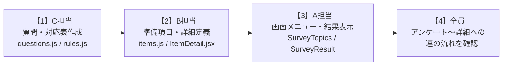

# 終活みちしるべ（チーム開発）

終活準備サポートWebアプリ「**終活みちしるべ**」の開発リポジトリです。  
（React + Vite + React Router + Context API）

---

## 1. 起動方法

```bash
npm install   # 初回のみ（パッケージ導入）
npm run dev   # 開発サーバー起動（http://localhost:5173/）
```

> 💡 **画面の確認方法**  
> 画面最上部の黒いバーにある「**画面一覧・テスト**」ボタンを押すと、いつでも全画面へ直接ジャンプでき、テスト用サンプルデータの適用もできます。

---

## 2. 担当分けと作業ファイル（計43h ＋ 予備2h）

各自、以下の**担当ファイル**を開いて作業を進めてください。

### ■ A担当（計17h）：画面・フロー統合
| 機能・作業 | 時間 | 作業ファイル |
|---|:---:|---|
| ① ホーム / ② 初回案内 | 3h | `src/pages/Home.jsx`<br>`src/pages/Guide.jsx` |
| ⑤ 生活状況アンケート画面（分岐） | 5h | `src/pages/SurveyTopics.jsx`<br>`src/pages/SurveyQuestions.jsx` |
| ⑥ 回答分析連携 / ⑦ 質問結果・提案表示 | 7h | `src/pages/SurveyResult.jsx`<br>`src/context/AppContext.jsx` |
| ⑨ やってみたいことリスト | 2h | `src/pages/WishList.jsx` |

### ■ B担当（計11h）：準備項目系
| 機能・作業 | 時間 | 作業ファイル |
|---|:---:|---|
| ③ 準備項目一覧（7項目） | 4h | `src/pages/ItemList.jsx` |
| ④ 準備状況・優先順位の管理 | 5h | `src/pages/ItemDetail.jsx`<br>`src/components/StatusBadge.jsx` |
| ⑧ 相談先・手続きガイド | 2h | `src/pages/ItemDetail.jsx`<br>`src/data/items.js` |

### ■ C担当（計9h）：データ設計・基本設定
| 機能・作業 | 時間 | 作業ファイル |
|---|:---:|---|
| ⑤ 質問データ作成 | 4h | `src/data/questions.js` |
| ⑥ 回答・提案の対応表作成 | 3h | `src/data/rules.js` |
| ⑩ 基本設定（名前・文字サイズ変更） | 2h | `src/pages/Settings.jsx` |

### ■ 全員（各2h / 計6h）
- **機能の統合・動作確認**: `src/App.jsx` および全画面の結合テスト

---

## 3. 質問・項目・画面を増やすときの連携手順（導線）

「新しい質問を増やし、それに連動する準備項目や画面を追加したい」ときは、**【C担当 → B担当 → A担当】** のリレー形式でファイルを編集します。



### 【手順1】C担当：質問データと提案ルールの作成
1. **質問を新しく作る**:
   - `src/data/questions.js` を開く。
   - `QUIZ_NODES` に新しい質問ID（例: `q_digital_1`）、質問文、選択肢、分岐先（`next`）を追加する。
2. **提案ルール（対応表）を紐付ける**:
   - `src/data/rules.js` を開く。
   - その選択肢を選んだときに、どの準備項目をおすすめするか（`suggest: "項目ID"`）を対応付ける。
3. （分野自体を新しく増やす場合のみ）:
   - `src/data/items.js` の `TOPICS` 配列に新分野（例: `{ id: "digital", t: "デジタル遺産" }`）を追加。

### 【手順2】B担当：準備項目（やること）と詳細画面の作成
1. **準備項目を新しく定義する**:
   - `src/data/items.js` を開く。
   - `ITEMS` 配列に、新しい準備項目（項目ID、タイトル、説明、準備手順 `steps`、公的相談先 `links`）を追加する。
   - ※ ここに追加するだけで、`src/pages/ItemList.jsx`（準備一覧）および `src/pages/ItemDetail.jsx`（詳細画面）に**自動的に新しい項目が表示**されます。
2. **詳細画面の表示を確認・調整する**:
   - `src/pages/ItemDetail.jsx` を開き、追加した項目の手順チェックボックスや相談先リンクが正常に動くか確認する。

### 【手順3】A担当：アンケート画面と結果画面の連携
1. **分野選択画面にメニュータイルを追加する**:
   - `src/pages/SurveyTopics.jsx` を開く。
   - `TOPIC_META` に新分野のアイコン（`icon`）と色（`color`）を指定する（ホーム風のメニュータイルに自動追加されます）。
2. **質問画面の動作を確認する**:
   - `src/pages/SurveyQuestions.jsx` で、C担当が作った新しい質問が表示され、選択肢によって次の質問へ分岐することを確認する。
3. **結果画面でのおすすめ表示を確認する**:
   - `src/pages/SurveyResult.jsx` で、アンケート回答後にB担当が作った準備項目が「新しく見つかった準備」として提案カードに正しく表示されるか確認する。

### 【手順4】全員：結合テスト（一連の導線チェック）
1. ブラウザで `/survey`（分野選択）を開く。
2. 新しい分野を選ぶ → 質問に答える → 結果画面におすすめが出る → 項目をタップして詳細手順を確認・チェックできる、という**最初から最後までの導線が繋がっていれば完成**です！

---

## 4. 開発ルール（Git）

- 作業開始時は各自のブランチを作成してください（例: `git checkout -b feature/survey`）
- 自分の担当ファイル（`src/pages/` や `src/data/`）を中心に編集することで、競合（コンフリクト）を防げます
- 変更を保存すると、Viteが自動で検知してブラウザ画面が更新されます
